# M-ui-foundation wireframes (wf-1)

**Status:** the design instrument for `uif-1`…`uif-17`. Per monster-realm #586 D2 (delegated, no operator gate) these are
best-judgment verdicts; the operator audits them through the comparison attached to the wf-1 PR and, at the end, to
`uif-17`'s PR. **Measured against** monster-realm `master` `d90c32c9`. **Bound by** the #586 answers in
[`M-ui-foundation.spec.md`](M-ui-foundation.spec.md); nothing here reopens them.

**Feedback items:** pt3-2026-10-013 (wireframe it), -014 (what grows, what scales, what stays), -015 (compare with the current design
and with similar games), -053 (the in-slot-buttons idea), -094 (every menu subtly different).

## How to read the diagrams

- **Each spread is one SVG:** CURRENT on the left, PROPOSED on the right, both at 1280×720. Open a spread at full size to read its text; the
  embedded image is scaled to the page.
- **CURRENT is measured, not remembered.** `wireframes/capture/wf1-capture.spec.ts` drove the real client at `d90c32c9` in Chromium by its own
  virtual buttons (two players, one in-memory server, a dev-reducers build). It recorded every visible element's rectangle, text, font,
  colors and borders into `wireframes/current/*.json`; `build.mjs` draws the left panel from those numbers alone. The matching screenshot
  of the real client is in `wireframes/shipped/`. When one screen has several states, the panel is a 2×2 grid labelled by capture.
- **PROPOSED is an original schematic:** boxes and labels from one small kit (`wireframes/screens.mjs`), solved at each window size from the
  token numbers in `wireframes/lib.mjs`. Nothing is copied from any game, and labels are illustrative where the content is dynamic.
- **Every PROPOSED element carries exactly one sizing annotation**, the colored letter at its top-right. An element's cross axis follows its
  parent; the letter names what the element does along the axis it owns.

| Letter | Annotation | Meaning |
|---|---|---|
| V | grows-vertically | Takes the free height of the window (the frame, its body, the board) |
| H | grows-horizontally | Takes the free width of its slot, up to the content maximum (cards, the side menu) |
| S | scales-with-resolution | Sized in rem, so it tracks `--mr-ui-scale` and the text-size step (titles, tabs, rows, chips, sheets) |
| F | fixed | Stays in CSS px at every size (2 px separators and borders) |

**Regenerate:** `node specs/monster-realm-v2/wireframes/build.mjs`. **Verify:** `node specs/monster-realm-v2/wireframes/check.mjs WF1.1` … `WF1.6` and
`--selftest`. **Re-measure** (for `uif-17`'s as-shipped section): copy `capture/` into a client checkout's `e2e/` per its header, run it, then
`build.mjs --import <dir>`.

## What the measurement shows

The operator's meta-finding (094) is measurable at a glance: on one window, the same frame opens six different title treatments and six
different tab positions. Heal's and Trade propose's headers sit at x 66 because a list-style indent never reset; Social has no title at all;
Inventory's title appears twice. Nothing grows with the window: at 1920×1080 Monsters' content is still 600 px wide with 14 px text.

<!-- generated:measured:begin -->
| Capture | Frame (x, y, w×h) | Title (font, x) | Tab strip (x, y, w×h) | First row or card (x, w) | Scrolls |
|---|---|---|---|---|---|
| `main-menu` | 849.5, 20, 406.5×648 | 14px bold, x 859.5 | none | x 891.5, w 362.5 | no |
| `monsters-party-two` | 8, 8, 1264×672 | 21px bold, x 589.4 | 571.4, 71.6, 137×22.4 | x 340, w 600 | yes |
| `monsters-storage-filled` | 8, 8, 1264×672 | 21px bold, x 589.4 | 571.4, 71.6, 137×22.4 | x 340, w 194.7 | no |
| `monsters-sheet` | 8, 8, 1264×672 | 21px bold, x 589.4 | 571.4, 71.6, 137×22.4 | x 340, w 600 | yes |
| `monsters-summary` | 8, 8, 1264×672 | 21px bold, x 589.4 | 571.4, 71.6, 137×22.4 | x 340, w 600 | yes |
| `inventory-food` | 8, 8, 1264×672 | 21px bold, x 583.1 | 513.5, 105.8, 253×22.4 | x 562.8, w 154.4 | no |
| `inventory-sheet` | 8, 8, 1264×672 | 21px bold, x 583.1 | 513.5, 105.8, 253×22.4 | x 562.8, w 154.4 | no |
| `inventory-picker` | 8, 8, 1264×672 | 21px bold, x 583.1 | 513.5, 105.8, 253×22.4 | x 562.8, w 154.4 | no |
| `inventory-pocket-2` | 8, 8, 1264×672 | 21px bold, x 583.1 | 513.5, 105.8, 253×22.4 | x 632, w 16 | no |
| `journal` | 8, 8, 1264×672 | 14px bold, x 26 | none |  | no |
| `social-players` | 8, 8, 1264×672 |  | 26, 22, 337×22.4 | x 26, w 1228 | no |
| `social-trades` | 8, 8, 1264×672 |  | 26, 22, 337×22.4 | x 26, w 1228 | no |
| `social-trades-sheet` | 8, 8, 1264×672 |  | 26, 22, 337×22.4 | x 26, w 1228 | no |
| `social-challenges` | 8, 8, 1264×672 |  | 26, 22, 337×22.4 |  | no |
| `social-rankings` | 8, 8, 1264×672 |  | 26, 22, 337×22.4 |  | no |
| `main-menu-profile` | 849.5, 20, 406.5×648 | 14px bold, x 859.5 | none | x 891.5, w 362.5 | no |
| `profile-name` | 8, 8, 1264×672 | 14px bold, x 34 | none | x 26, w 1228 | no |
| `profile-account` | 8, 8, 1264×672 | 14px bold, x 34 | none | x 26, w 56.8 | no |
| `profile-privacy` | 8, 8, 1264×672 | 21px bold, x 26 | none | x 26, w 50.1 | no |
| `help-screen` | 8, 8, 1264×672 | 14px normal, x 26 | 26, 44.4, 292×22.4 |  | no |
| `help-goals` | 8, 8, 1264×672 | 14px normal, x 26 | 26, 44.4, 292×22.4 |  | no |
| `controls-buttons` | 8, 8, 1264×672 | 21px bold, x 26 | 26, 90.4, 171×22.4 | x 26, w 614 | no |
| `controls-shortcuts` | 8, 8, 1264×672 | 21px bold, x 26 | 26, 90.4, 171×22.4 | x 26, w 409.3 | no |
| `main-menu-options` | 849.5, 20, 406.5×648 | 14px bold, x 859.5 | none | x 891.5, w 362.5 | no |
| `shop-buy` | 8, 8, 1264×672 | 14px normal, x 34 | 26, 82.4, 95×22.4 | x 66, w 1188 | no |
| `shop-qty` | 8, 8, 1264×672 | 14px normal, x 34 | 26, 82.4, 95×22.4 | x 66, w 1188 | no |
| `shop-confirm` | 8, 8, 1264×672 | 14px normal, x 34 | 26, 82.4, 95×22.4 | x 66, w 1188 | no |
| `shop-sell` | 8, 8, 1264×672 | 14px normal, x 34 | 26, 82.4, 95×22.4 | x 66, w 1188 | no |
| `heal` | 8, 8, 1264×672 | 14px normal, x 66 | none | x 26, w 1228 | no |
| `dialogue` | 8, 8, 1264×672 | 14px normal, x 28 | none | x 10, w 1260 | no |
| `tradepropose-offer` | 8, 8, 1264×672 | 14px normal, x 66 | none | x 26, w 1228 | no |
| `tradepropose-coins` | 8, 8, 1264×672 | 14px normal, x 66 | none | x 26, w 1228 | no |
| `tradepropose-review` | 8, 8, 1264×672 | 14px normal, x 66 | none | x 26, w 1228 | no |
| `tradepropose-confirm` | 8, 8, 1264×672 | 14px normal, x 66 | none | x 26, w 1228 | no |
| `world-picker` | none |  | none |  | no |
| `world-challenge-confirm` | none |  | none |  | no |
| `world-request-banner` | none |  | none |  | no |
| `world-request-sheet` | none |  | none |  | no |
| `tactics-deploy` | 8, 8, 1264×672 | 14px normal, x 26 | none | x 26, w 1228 | no |
| `tactics-deploy-editor` | 8, 8, 1264×672 | 13.3333px normal, x 26 | none | x 26, w 32 | no |
| `tactics-forecast` | 8, 8, 1264×672 | 14px normal, x 18 | none | x 85, w 79 | no |
| `tactics-menu` | 8, 8, 1264×672 | 14px normal, x 18 | none | x 85, w 79 | no |
| `tactics-results` | 8, 8, 1264×672 | 14px normal, x 26 | none | x 26, w 69.4 | no |
<!-- generated:measured:end -->

## Verdicts (#586 D2)

### Verdict: sheet placement

**Verdict:** (#586 D2, best judgment) corner-anchored, in the frame body's bottom corner horizontally away from the selected slot, growing upward; nothing dimmed.
The Party becomes a 2×3 grid so every slot leaves the opposite half free. Bottom edge rests above the feedback strip. Width is
min(18rem, 45% of the body).

**Reason:** it follows one rule on every screen, window and text size, at the price of a tiny pure function, and for the grids it lands in one of only two places, the two bottom
corners. The operator's complaint (047) is a sheet wedged between tabs and panels with no border; the handheld precedent (research §4) answers it with one frame family, a corner, size from option count, grow
away from the anchor. Research's own claim that a corner avoids flip logic holds only for a truly fixed corner, which cannot satisfy "does not cover the selected slot", so this rule pays for one choice of side and,
for full-width rows only, one vertical flip.

| Option | Party | Storage grid | Inventory, Social rows | 640×240, or text ×2 | Code | Outcome |
|---|---|---|---|---|---|---|
| **fixed single corner** (the pure Gen 3 form) | Covers a bottom-right slot | Covers a bottom-right tile | Covers the last rows | Scrolls | None | Rejected: it covers the selected slot for some slots, which is the one thing the sheet must not do |
| **corner-anchored** (one of the two bottom corners; a top corner only over a full-width row) | Clear: opposite half | Clear: opposite half | Flips vertically when a full-width row is under it, then caps and scrolls | Caps to the free band and scrolls | One pure function | **Chosen** |
| **beside-the-slot** | Needs a side gutter | Next to a right-edge tile it must flip; a mid-grid tile has no side free without covering neighbors | Same flip logic | Clamp and flip stack up; the sheet jumps with each slot | Clamp and flip logic per research §4 | Rejected: the position changes with every slot rather than between two places, so a D-pad player has no stable place to look, and it still needs the flip logic |
| **in-slot-buttons + detail page (053)** | Works on today's list, per 053 itself; the 2×3 grid below would remove that too | Fails, per 053 itself: all four directions are taken, so left/right cannot select a button | No slot-sized target | Buttons do not fit a 98 px slot at ×2 | Two interaction models | Rejected for the buttons, because the operator's own note says it breaks on the grid, and two models is the inconsistency 094 objects to. **Its detail page is adopted** as the Summary page |

The anchor rule (`anchorSheet` in `wireframes/lib.mjs`, proven by `check.mjs` over every proposed slot at five window sizes and three text steps):
horizontally away from the slot's center; try the bottom corner; if it would touch the slot, try the top corner; if neither clears, cap the sheet's
height to the taller free band and scroll it. Clicking outside closes then routes (`uif-5`), so a sheet covering other slots costs one click, not two
(046). No dim, because 046 expects the rest of the screen to stay live; a dim layer would have to block it (research §4, fake modals).

### Verdict: Summary page

**Verdict:** a full page in the Monsters frame replacing the grid, tabs kept, showing every stat; B returns to the sheet on the same monster. This is
the spec's default and the #586 D2 recommendation, confirmed.

**Reason:** today Summary is a third layer stacked under the sheet and above the panel (`monsters-summary`, one screen with sheet, pane, heading and
slots all in flow). A page makes room for all stats without a second overlay, keeps the operator's detail-page instinct (053), and needs no new
`OverlayId` because it is an adapter phase. Up/Down to change monster (the Gen 3 "vertical = entity" idiom, research §2) is rejected for now: Up/Down
already walks the page's rows, and nothing asks for it; a later ask can add it inside the same phase.

### Verdict: Profile section order

**Verdict:** Name, then Account, then Privacy, then Close, in one column (the spec's default, confirmed). The cursor opens on Name unless the claim prompt or a
sign-in failure routes to Account (`UIF16B.5`).

**Reason:** the order runs from most routine to most consequential. Name is the common visit. Account decides where progress lives. Privacy holds deletion, the one
irreversible action in the menus, so it belongs furthest from the default cursor (research §3: default to the safe target; §4: do not pre-focus the destructive
answer). Close at the bottom follows 104. The alternative of Account first (it is what auto-opens) is rejected because the cursor routing already delivers it, and
a stable order preserves spatial memory.

## Token table (WF1.5)

Values for `uif-1`. Spacing, type and sizes are rem so `uif-2`'s root scale reaches them. **Border widths stay in CSS px**, as `--mr-border-width: 2px` and
`--mr-border-thin: 1px`: at a continuous scale a rem border lands on fractional device pixels and shimmers, the failure research §9 names. Colors and pairs:

<!-- generated:tokens:begin -->
| Token | Value | `prefers-contrast: more` |
|---|---|---|
| `--mr-frame-bg` | `#1e1e2e` | `#101018` |
| `--mr-panel-bg` | `#181826` | `#000000` |
| `--mr-frame-fg` | `#e0e0e0` | `#ffffff` |
| `--mr-frame-border` | `#e0e0e0` | `#ffffff` |
| `--mr-separator` | `#6b6b82` | `#bbbbbb` |
| `--mr-text-muted` | `#b4b4c2` | `#dddddd` |
| `--mr-text-disabled` | `#8a8a9a` | `#aaaaaa` |
| `--mr-state-ok` | `#34d399` | `#6ee7b7` |
| `--mr-state-warn` | `#f59e0b` | `#fcd34d` |
| `--mr-state-error` | `#f87171` | `#fca5a5` |
| `--mr-focus` | `#ffd866` | `#ffe08a` |

| Pair | Floor | Measured | Measured (`more`) |
|---|---|---|---|
| Body text on frame | 4.5:1 | 12.42:1 | 18.93:1 |
| Body text on panel | 4.5:1 | 13.28:1 | 21.00:1 |
| Muted text on frame | 4.5:1 | 8.00:1 | 13.94:1 |
| Muted text on panel | 4.5:1 | 8.56:1 | 15.46:1 |
| Disabled text on frame | 3:1 | 4.83:1 | 8.15:1 |
| Disabled text on panel | 3:1 | 5.16:1 | 9.04:1 |
| Focused row (inverted fill) | 4.5:1 | 12.42:1 | 18.93:1 |
| Separator on frame | 3:1 | 3.16:1 | 9.86:1 |
| Separator on panel | 3:1 | 3.38:1 | 10.94:1 |
| State ok on frame | 3:1 | 8.53:1 | 12.42:1 |
| State warn on frame | 3:1 | 7.64:1 | 13.13:1 |
| State error on frame | 3:1 | 5.93:1 | 9.97:1 |
| Focus ring on frame | 3:1 | 11.92:1 | 14.68:1 |

| Spacing token | rem | px at uiScale 1 |
|---|---|---|
| `--mr-space-1` | 0.25 | 4 |
| `--mr-space-2` | 0.5 | 8 |
| `--mr-space-3` | 0.75 | 12 |
| `--mr-space-4` | 1 | 16 |

| Type token | rem | px at uiScale 1 | Weight | Line height |
|---|---|---|---|---|
| `--mr-font-title` | 1.25 | 20 | bold | 1.4 |
| `--mr-font-header` | 1 | 16 | bold | 1.4 |
| `--mr-font-body` | 0.875 | 14 | normal | 1.6 |
| `--mr-font-small` | 0.75 | 12 | normal | 1.4 |
<!-- generated:tokens:end -->

**Reused values:** `--mr-frame-bg`, `--mr-frame-fg` and `--mr-frame-border` are unchanged; the `more` tier matches the shipped `--mr-evo-*` tier where a role overlaps. `--mr-text-disabled`
is the shipped `.mr-nav-item.is-disabled` color. The `.is-active.is-disabled` row keeps its shipped `#55556a` on the focused fill (5.50:1 on `#e0e0e0`).

**Focus:** `--mr-focus` is the ring around a focused non-row control. A focused row keeps its inverted fill, ▶ glyph and inner `--mr-frame-bg` outline, as qf-1 shipped them, because a ring in the focus
color would have no contrast against that fill. **Selected tab:** panel-colored fill joined to the panel, bold weight, 2 px `--mr-frame-border` outline (three cues), never the inverted fill, so "which tab" and
"which row" can both be true (060, 169; research §7).

**Roles:** a card or panel fills with `--mr-panel-bg` and a `--mr-border-thin` `--mr-separator` border, replacing the shipped `#1a1a2e`/`#444` card literals. A sheet or frame fills with `--mr-frame-bg` and a `--mr-border-width` `--mr-frame-border` border. A chip fills with `--mr-frame-bg` and a thin `--mr-frame-border` border. A toast fills with `--mr-panel-bg` and a border in its state color. The feedback strip fills with `--mr-panel-bg` under a `--mr-separator` top rule. The scroll cue's thumb is `--mr-separator`.

**Geometry at 1280×720 (for `UIF1.5`):**

| Part | Rect or size | Token |
|---|---|---|
| Menu frame (`.mr-shell`) | 8, 8, 1264×672 (shipped, unchanged) | inset `--mr-space-2`, bottom 2.5rem |
| Side frame (`.mr-frame--side`) | 849.5, 20, 406.5×648 (shipped, unchanged) | 33% wide, inset `--mr-space-3` |
| Hint bar | 0, 689.2, 1280×30.8 (shipped, unchanged) | 1.925rem, padding `--mr-space-1` `--mr-space-2`, gap `--mr-space-2` |
| Title bar | 2.5rem | `--mr-font-title`, padding `--mr-space-1` `--mr-space-2` |
| TabBar | 2rem row, chips 3.25rem, tabs share the strip evenly up to 7.5rem each, qf-11's `overflow-x: auto` kept for extreme text steps | `--mr-font-body`, gap `--mr-space-1` |
| Nav row | 1.65rem, measured 26.4 px | `--mr-font-body`, shipped `.mr-nav-item` padding |
| Feedback strip | 1.75rem overlay, zero layout height | `--mr-font-small` |
| Toast | top-right of the screen, below the title bar's line, 18rem wide | `--mr-font-body`, inset `--mr-space-3` |

### Scale

<!-- generated:scale:begin -->
`UI_SCALE_MIN` = 0.875, `UI_SCALE_MAX` = 3, reference 720 CSS px on the shorter axis. `--mr-content-max` = 80rem. Sheet width = min(18rem, 45% of the body).

| Window (css, dpr) | continuous | deviceScale | uiScale | Body text | 1rem | Content width |
|---|---|---|---|---|---|---|
| 640×240, 1 | 0.68 | 1 | 0.875 | 12.25 px | 14.0 px | 622 px |
| 960×540, 1 | 1.53 | 2 | 0.875 | 12.25 px | 14.0 px | 942 px |
| 1280×720, 1 | 2.05 | 2 | 1.000 | 14.00 px | 16.0 px | 1260 px |
| 1536×864, 1.25 | 3.07 | 3 | 1.200 | 16.80 px | 19.2 px | 1513 px |
| 1920×1080, 1 | 3.07 | 3 | 1.500 | 21.00 px | 24.0 px | 1892 px |
| 2560×1440, 1 | 4.09 | 4 | 2.000 | 28.00 px | 32.0 px | 2524 px |
| 3440×1440, 1 | 4.09 | 4 | 2.000 | 28.00 px | 32.0 px | 2560 px (capped) |
| 3840×2160, 1 | 6.14 | 6 | 3.000 | 42.00 px | 48.0 px | 3788 px |
<!-- generated:scale:end -->

**Checked against the spec's table:** `check.mjs WF1.5` parses the six rows of the scale table in `M-ui-foundation.spec.md` and recomputes `continuous`, `deviceScale`, `uiScale` and body size from the formula; all six match. The floor
of 0.875 holds body at 12.25 px, which at a 960×540 window is proportionally larger than the research's PC floor of 18 px at 1080p; the 3.00 ceiling is reached exactly at 2160 px. **The 80rem content maximum** is just above a
16:9 window's own width in rem (about 78.8rem at every size, because rem tracks the shorter axis), so it never gutters a 16:9 or narrower window and only caps ultrawide. Prose columns (Introduction, Encyclopedia detail) cap at `80ch`
(research §6) without a token.

### Channel table

Every measured message kind at `d90c32c9` (grep of the sinks; the spec's "ten sinks"). The hint line has two hosts with one behavior: inside a frame, the feedback strip; at the world, the status line, walk-up chip and notice banner, kept
as shipped but restyled. `UIF4.1`'s `MessageKind` union takes these names; `UIF4.6`'s literal action-required list is the "yes" rows on the Toast channel, each with what also carries it.

<!-- generated:channels:begin -->
| Kind | Channel | Sink at d90c32c9 | Player must act | Also carried by |
|---|---|---|---|---|
| `y-description` | Hint line | menuView `renderFeedback` | no |  |
| `disabled-reason-menu` | Hint line | menuView `renderFeedback` | no |  |
| `disabled-reason-row` | Hint line | boxView row suffix; healView `#reason`; tradeProposeView | no |  |
| `capture-prompt` | Hint line | controlsView `#capture` | yes | the capture prompt itself |
| `controls-refused` | Hint line | controlsView `showFeedback` | yes | the capture prompt still waits |
| `claim-veto` | Hint line | claimView `#feedback` | yes | the pending claim rows |
| `walkup-chip` | Hint line | `#interact-prompt` | no |  |
| `walkup-choose` | Hint line | `#interact-prompt` | no |  |
| `trade-request` | Hint line | `.mr-notice-banner` (`requestLine`) | yes | the notice banner and the Start-chip badge |
| `challenge-request` | Hint line | `.mr-notice-banner` (`requestLine`) | yes | the notice banner and the Start-chip badge |
| `deletion-countdown` | Hint line | `#privacy-countdown` | no |  |
| `privacy-notice` | Hint line | privacyView `#notice` | no |  |
| `world-disconnect` | Hint line | `statusEl` (`onError`) | no |  |
| `connect-failure` | Hint line | `statusEl` (`onError`) | no |  |
| `content-stale` | Hint line | `statusEl` (`reportError`) | yes | the world hint line until reload |
| `download-blocked` | Hint line | `statusEl` (`reportError`) | yes | the world hint line until overwritten |
| `care-success` | Toast | boxView `feedbackLine` / `OutcomeLine` | no |  |
| `care-rejected` | Toast | `performCare` via `OutcomeLine` | no |  |
| `monsters-move-ok` | Toast | boxView `#feedbackEl` | no |  |
| `feed-ok` | Toast | boxView `#feedbackEl`; raisingView `#bagStatus` | no |  |
| `feed-rejected` | Toast | `OutcomeLine`; `statusEl` from Inventory | no |  |
| `bag-feed-blocked` | Toast | raisingView `#bagStatus` | no |  |
| `party-full` | Toast | `statusEl` (`reportError`) | yes | the six filled Party slots and the Move row |
| `party-move-rejected` | Toast | `statusEl` (`sendGuarded`) | no |  |
| `nickname-rejected` | Toast | `statusEl` (`sendGuarded`) | no |  |
| `evolve-rejected` | Toast | `statusEl` (`sendGuarded`) | no |  |
| `heal-unavailable` | Toast | `statusEl` (`reportError`) | no |  |
| `heal-rejected` | Toast | `statusEl` (`sendGuarded`) | no |  |
| `shop-buy-ok` | Toast | shopView `showFeedback` | no |  |
| `shop-sell-ok` | Toast | shopView `showFeedback` | no |  |
| `shop-rejected` | Toast | shopView `showFeedback` | no |  |
| `trade-answered` | Toast | tradeView `showFeedback` | no |  |
| `trade-settled` | Toast | tradeView `showFeedback` | no |  |
| `trade-cancelled` | Toast | tradeView `showFeedback` | no |  |
| `trade-rejected` | Toast | tradeView `showFeedback` | no |  |
| `trade-offer-sent` | Toast | tradeProposeView `showFeedback` | no |  |
| `trade-propose-rejected` | Toast | tradeProposeView `showFeedback` | no |  |
| `rename-saved` | Toast | renameView `showFeedback` | no |  |
| `rename-rejected` | Toast | renameView `showFeedback` | no |  |
| `controls-saved` | Toast | controlsView `showFeedback` | no |  |
| `controls-cancelled` | Toast | controlsView `showFeedback` | no |  |
| `controls-save-failed` | Toast | controlsView `showFeedback` | no |  |
| `pvp-rejected` | Toast | `statusEl` (`sendGuarded`) | no |  |
| `link-down-send` | Toast | `sendGuarded` to `statusEl` / `OutcomeLine` | yes | the `world-disconnect` hint line, on the frame strip while a frame is open |
| `link-down-view` | Toast | `performCare`; `#session-feedback`; `#claim-feedback` | yes | the `world-disconnect` hint line, on the frame strip while a frame is open |
| `privacy-busy` | Toast | `statusEl` (`reportError`) | yes | the other overlay stays on screen; the kind retires in `uif-16b` |
| `zone-cue` | Toast | `showNotice` to `statusEl` | no |  |
| `dialogue-ended` | Toast | `showNotice` to `statusEl` | no |  |
| `quest-complete` | Toast | `showNotice` to `statusEl` | no |  |
| `world-send-rejected` | Toast | `statusEl` (`sendGuarded`) | no |  |
| `battle-refused` | Toast | `refusedInBattle` (held in `statusEl` until the battle ends today; timed after) | no |  |
| `queue-too-late` | Toast | `showNotice` to `statusEl` | no |  |
| `battle-command-rejected` | Toast | `statusEl` (`sendGuarded`) | yes | the command menu, re-armed for the same turn |
| `evolution-reveal` | Modal | evolutionNotice banner (stays as shipped: named deferral) | yes | the banner until acknowledged |
| `evolve-confirm` | Modal | boxView confirm phase | yes |  |
| `decline-confirm` | Modal | socialScreen sheet | yes |  |
| `trade-final-confirm` | Modal | socialScreen sheet | yes |  |
| `trade-send-confirm` | Modal | tradeProposeView confirm | yes |  |
| `challenge-confirm` | Modal | world sheet (`challengeLayout`) | yes |  |
| `buy-sell-confirm` | Modal | shopScreen confirm phase | yes |  |
| `heal-confirm` | Modal | healView rows | yes |  |
| `controls-reset-confirm` | Modal | optionsScreen `confirmLayout` | yes |  |
| `deletion-phase-confirm` | Modal | privacyView phases | yes |  |
| `npc-dialogue` | Blocking text box | dialogueView | yes |  |

In-battle HUD, not policy kinds (screen content, stays as shipped under `uif-11`): `ticker-action`, `ticker-status`, `ticker-plan-halted`, `ticker-recruit`, `ticker-awards`, `ticker-flow`, `command-greyed-reason`, `still-there`, `deploy-sending`, `results-rewards`.
<!-- generated:channels:end -->

**One strip, one message:** a frame has one hint line, so kinds resolve by precedence: an action-required hint, then a persistent state (`world-disconnect`, `connect-failure`), then a disabled reason, then a Y-description. `deletion-countdown` keeps its own `#privacy-countdown` line and the requests their banner, so neither competes for the strip.

**Measured along the way, each a reason for the table:** `pvpView.showFeedback` has no caller, so nine sinks are live, not ten, and PvP failures reach only `statusEl`. `.mr-status` paints at z-index 45 under `.mr-shell`'s 100, so a `statusEl` rejection
from inside a frame (`party-full`, `nickname-rejected`, `evolve-rejected`) can land under the frame; the toast's "above frames" (`UIF4.2`) is what fixes it. `tradeFeedback` paints only while `tradeView` shows, so an answer sent from the world sheet shows no result; the toast fixes that too.

## Amendments (WF1.6)

### Amendments made in this diff

Each verdict that differs from a spec default, or that the spec left open, amended in `M-ui-foundation.spec.md` here. The Summary and Profile verdicts confirm their defaults and change nothing.

- **WF1-A1** (`UIF3.4`): the anchor's rule and domain. "Never cover that slot for any slot position" is unsatisfiable for a slot wider than the free width and taller than the free height, so the property now states horizontal-away, bottom-then-top, and the cap.
- **WF1-A2** (`UIF3.3`): the sheet's width rule, min(18rem, 45% of the body).
- **WF1-A3** (`UIF6.8`, new; `uif-6` touches): the Party renders as a 2-column, 3-row grid and the D-pad moves per the layout (102), the precondition of the sheet verdict. `monstersModel.ts`, its test and `reachability.test.ts` join `uif-6`, which runs serially before `uif-7`.
- **WF1-A4** (`uif-1` Measured; the tokens paragraph): border widths are px tokens, the one exception to "every px shorthand moves to rem", and the token list gains them.
- **WF1-A5** (`uif-4b` Measured): `pvpView.showFeedback` is dead and retires here; `statusEl` under frames and the dropped world-sheet answer are recorded for `uif-4`.
- **WF1-A6** (`uif-10` Measured): the trade-propose step header takes the TabBar's slot and geometry but stays an `ol` with `aria-current="step"`, which e2e pins.
- **WF1-A7** (`uif-11` Measured; `UIF11.6`, new): the command menu's rows move to the 1.65rem nav-row height under `UIF11.3`, so the open dock grows from 156 px to about 176 px at ×1 and the board gives up that height, a named cost of one row treatment. At doubled text the board keeps 30% of the frame, the ticker shrinking first.
- **WF1-A8** (`UIF3.3`; `uif-14` Measured): a detail variant of the ContextSheet for the Encyclopedia entry, so `uif-5`'s pointer rule and `[data-context-sheet]` reach it.
- **WF1-A9** (`UIF4.5`): a persistent hint kind follows the top: on the open frame's strip, else on the world line, under the precedence below the channel table.
- **WF1-A10** (`uif-16b` touches and Measured): `privacy-busy` retires from `feedbackPolicy` when Profile becomes one dialog.

**Launch order:** `uif-1` stays `after: [wf-1]`, and every other `uif-*` chains from it, so no `uif-*` slice launches before this merges.

## Screens

The five named contracts from `docs/research/retro-rpg-menu-ui-design.md`: **tab-bar contract** (§2, implication 3), **list and grid contract** (§3, implication 4), **context-menu contract** (§4, implication 5), **message channels** (§5, implication 6), **empty states** (§8, implication 7).

### main-menu

[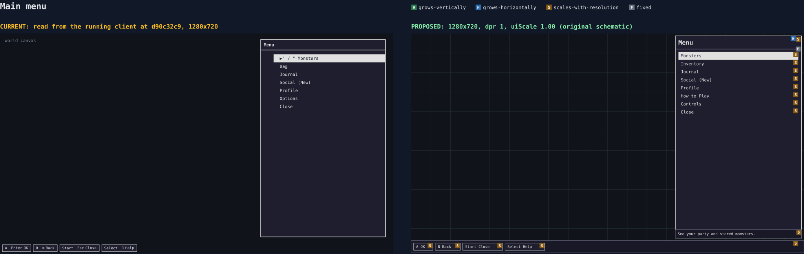](wireframes/svg/main-menu.svg)
[Three window sizes](wireframes/svg/main-menu-sizes.svg) · shipped: [root](wireframes/shipped/main-menu.jpg), [1920×1080](wireframes/shipped/main-menu-1920.jpg), [960×540](wireframes/shipped/main-menu-960.jpg), [Social](wireframes/shipped/main-menu-social.jpg), [Options](wireframes/shipped/main-menu-options.jpg)

**Measured:** a side frame 33% wide; rows stay 26.4 px at every window, so at 1920×1080 the rows end a quarter of the way down a 1008 px frame. Three entries open sub-lists inside the same box (079, 097, 109).
**Genre:** list and grid contract (short menu wraps); message channels (a prompt line, as in the Gen 3 party's bottom message); XAG 112's fixed title and prompt position.
**Adopted:** the #586 D3 list with Close last (025, 104); a side frame so the world stays visible; the Y-description in the strip at the frame's foot.
**Rejected:** shrinking the frame to its rows, because the strip would then ride up and down with the row count, and a full-height frame is what leaves room for eight rows at text ×2 on a short window. Sub-lists go because 079 and 109 object to them.

### monsters-party

[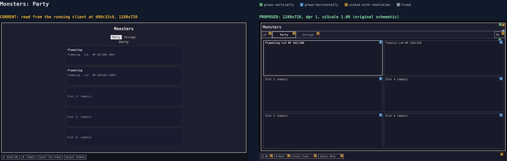](wireframes/svg/monsters-party.svg)
[Three window sizes](wireframes/svg/monsters-party-sizes.svg) · shipped: [Party, two monsters](wireframes/shipped/monsters-party-two.jpg), [1920×1080](wireframes/shipped/monsters-party-1920.jpg)

**Measured:** content is a 600 px centered column at x 340 (x 660 at 1920×1080); title 21 px, tabs at y 71.6, an in-panel "Party" heading at y 94 repeating the selected tab; six 98 px slots overflow, so the sixth is cut off at the frame's foot at 1280×720.
**Genre:** tab-bar contract (LB/RB chips, two or more cues); list and grid contract (grid moves to the tile in that direction, clamp, no loop). Coromon has a Squad dropdown and a storage grid.
**Adopted:** tabs through the TabBar; a 2×3 grid that grows to the free space up to the content maximum (038, 045), all six slots visible; heading dropped (`R-qf-10-QF10.2`).
**Rejected:** a one-column list, because six full-width rows fit only by scrolling or shrinking, and a full-width row forces the sheet to flip between top and bottom as the cursor moves, against a stable bottom corner here. The grid costs 053's left/right idea on Party, as the verdict's table states. The Gen 3 "big first card" is rejected because it needs a second card size for no gain.

### monsters-storage

[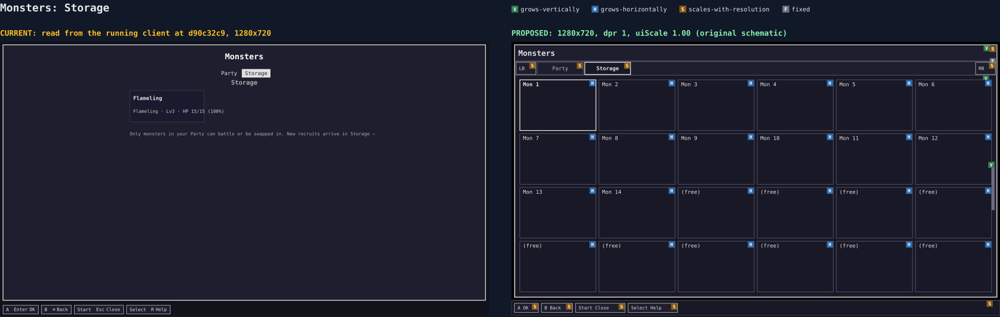](wireframes/svg/monsters-storage.svg)
[Three window sizes](wireframes/svg/monsters-storage-sizes.svg) · shipped: [with a recruit](wireframes/shipped/monsters-storage-filled.jpg), [empty](wireframes/shipped/monsters-storage.jpg)

**Measured:** a single 195×83 tile on the column's left edge with the explanation below it; the empty state is two paragraphs at x 340; a long grid scrolls the shell, moving the tabs away.
**Genre:** list and grid contract (Coromon's storage grid; pseudo-scroll under D-pad); empty states (reason, cue, next step).
**Adopted:** edge scroll, because `navRender` already calls `scrollIntoView({ block: 'nearest' })`; overflow hidden with a position cue, the wheel moves the cursor (039, 040); EmptyState when empty, tabs kept.
**Rejected:** centre-pinned scrolling (the handheld norm), because it would need a second scroll model beside the shipped one, and research finds no player preference. Page-jump on LB/RB is rejected since those step tabs.

### monsters-sheet

[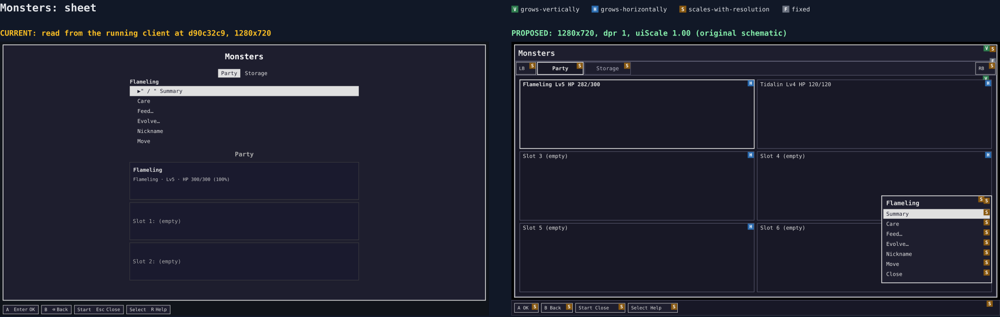](wireframes/svg/monsters-sheet.svg)
Shipped: [sheet](wireframes/shipped/monsters-sheet.jpg), [Feed list](wireframes/shipped/monsters-feed.jpg)

**Measured:** an unbordered 600 px block in flow between tabs and panel, pushing the slots down by 189 px (047); no Back row (049); a sub-list stacks under the sheet instead of replacing it.
**Genre:** context-menu contract (same frame, fixed corner, sized by options, returns to its row); Gen 3's party menu grows upward from the bottom-right.
**Adopted:** the placement verdict above; a last Close row whose A equals B (049, 104); Feed… and Evolve… replace the rows in the same sheet with a last Back row.
**Rejected:** a dimmed modal, because 046 expects a click on another slot or tab to work. See the verdict for beside-the-slot and in-slot buttons.

### monsters-summary

[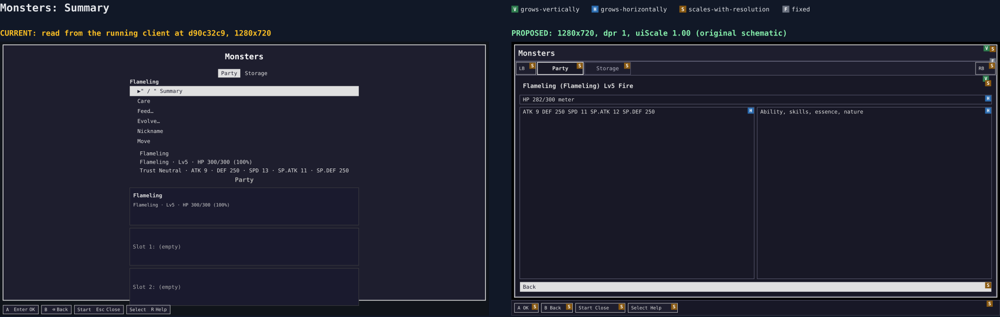](wireframes/svg/monsters-summary.svg)
Shipped: [Summary pane](wireframes/shipped/monsters-summary.jpg)

**Measured:** three text lines under the still-open sheet, above the Party heading, with five kinds of block stacked in one column.
**Genre:** tab-bar contract (the frame keeps its tabs); list and grid contract (Gen 3's summary is a page, not a pane; a list where rows need text).
**Adopted:** the Summary verdict above.
**Rejected:** a modal over the grid, because all stats need more room than a sheet and the grid behind it would be unreadable anyway. Left/Right paging by stat group is rejected since LB/RB already step the frame's tabs, and two lateral idioms would conflict.

### inventory

[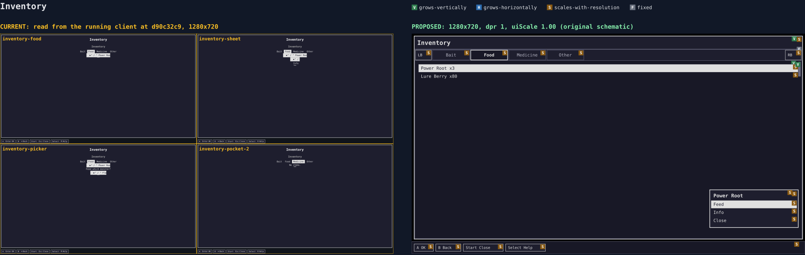](wireframes/svg/inventory.svg)
Shipped: [Food pocket](wireframes/shipped/inventory-food.jpg), [item sheet](wireframes/shipped/inventory-sheet.jpg), [picker](wireframes/shipped/inventory-picker.jpg), [empty pocket](wireframes/shipped/inventory-pocket-2.jpg)

**Measured:** root `align-items:center`, so the list shrinks to its longest label (154 px); "Inventory" appears twice; tabs at y 105.8; the sheet and picker stack as more centered lines; "No items." has no cue.
**Genre:** tab-bar contract (Gen 3 Bag pockets, here as a strip for consistency); list and grid contract; context-menu contract (Bag menus share one corner); empty states.
**Adopted:** the same frame as Monsters; pockets in the TabBar; full-width rows with the position cue; the corner sheet, full-width rows flipping per the anchor rule; EmptyState per pocket.
**Rejected:** Gen 3's single pocket label with arrows, because tabs elsewhere are a strip, and 060 asks for consistency. A description pane is rejected since the sheet's Info row carries it and a new pane would be a new per-screen part.

### journal

[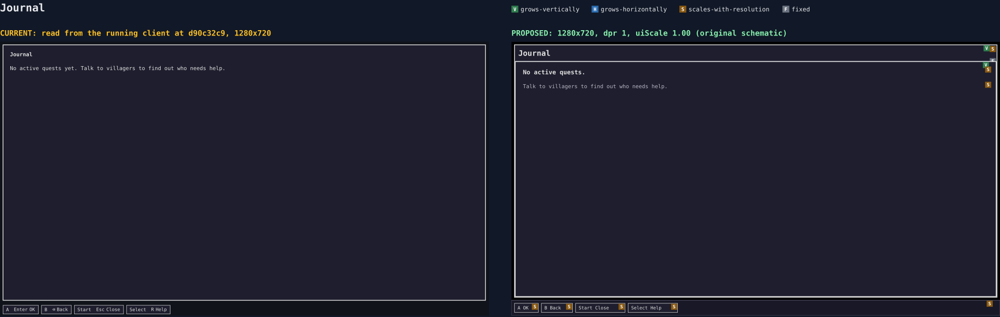](wireframes/svg/journal.svg)
Shipped: [empty](wireframes/shipped/journal.jpg)

**Measured:** title 14 px bold at x 26 where Monsters' is 21 px centered; one sentence of copy (qf-4).
**Genre:** empty states (NN/g's status, cue, pathway; a journal stays useful most when empty); list and grid contract when it has rows.
**Adopted:** the anatomy and EmptyState, with the existing copy as its reason (`UIF10.2`).
**Rejected:** a focusable next-step row, because no row can act on it (the next step is walking to a villager); focus stays on the shipped `#quest-log-list` anchor, styled per the M23 rule. Tabs for active and done quests are rejected since nothing ships a done list.

### social-players

[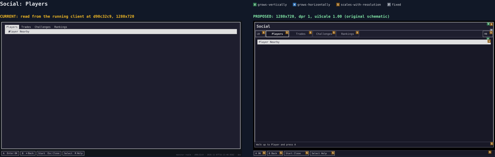](wireframes/svg/social-players.svg)
Shipped: [Players](wireframes/shipped/social-players.jpg)

**Measured:** no title; tabs at y 22, left-aligned, the only frame that opens on tabs; the Players hint sits as body text.
**Genre:** tab-bar contract (MMO social menus use four tabs); list and grid contract (a default cursor on the safe row).
**Adopted:** one title, one TabBar across all four panels with one geometry (`UIF9.1`); the walk-up hint stays in the panel as a muted line, since it is static instruction, not a message.
**Rejected:** a row sheet on Players, because the shipped action is to walk up to the player, which is what its hint says; a sheet here would offer nothing.

### social-trades

[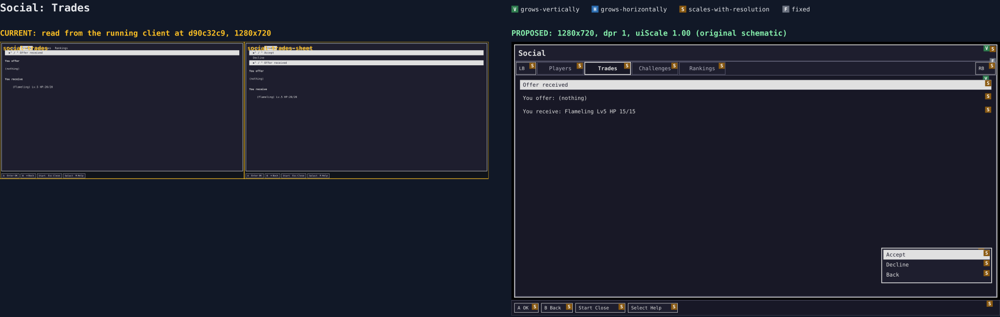](wireframes/svg/social-trades.svg)
Shipped: [Trades](wireframes/shipped/social-trades.jpg), [row sheet](wireframes/shipped/social-trades-sheet.jpg)

**Measured:** a full-width row, then the offer's lines in flow, with the sheet appearing above them; body padding differs from Players' and Rankings' (089).
**Genre:** context-menu contract (the sheet); list and grid contract (rows that need comparison carry a detail).
**Adopted:** ContextSheet with a last Back row, Decline and final Confirm in the confirm variant with the shipped No default (`UIF9.2`); identical padding across the four tabs.
**Rejected:** per-trade RowCards in this milestone, because M-trade-sessions `ts-3` rebuilds this tab and a migration here would be redone there (named deferral, 086).

### social-challenges

[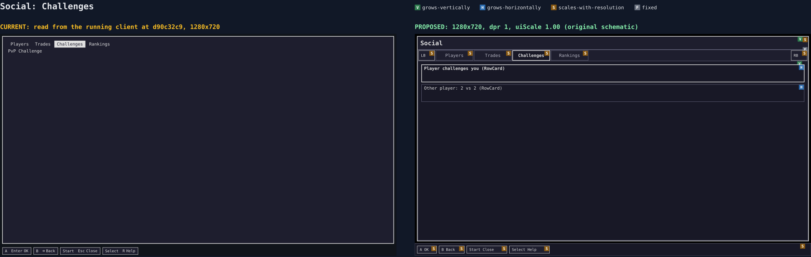](wireframes/svg/social-challenges.svg)
Shipped: [Challenges](wireframes/shipped/social-challenges.jpg)

**Measured:** a "PvP Challenge" heading at y 44 over an empty panel, with no state message.
**Genre:** list and grid contract (one row per entry); empty states.
**Adopted:** RowCard per challenge with visible separation, the first RowCard consumer; EmptyState when none.
**Rejected:** a table with columns, because cards already carry a name and a size in two lines, and columns would be a one-off part on a screen with so few fields.

### social-rankings

[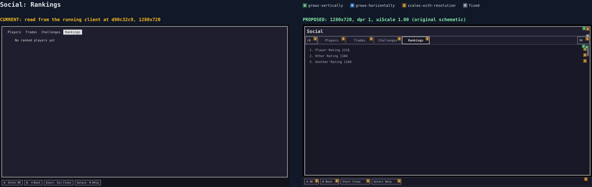](wireframes/svg/social-rankings.svg)
Shipped: [Rankings](wireframes/shipped/social-rankings.jpg)

**Measured:** read-only rows with qf-16's scroll shadow; the empty line sits at x 66 from a list-style indent where other tabs start at x 26.
**Genre:** list and grid contract (scroll cue; read-only rows are not actionable); empty states.
**Adopted:** muted read-only rows, distinct from actionable ones (`UIF1.3`); qf-16's cue on the shared `.mr-scroll` (`UIF9.5`).
**Rejected:** a cursor over read-only rows, because a cursor implies an action, and qf-16 removed exactly that cue.

### profile

[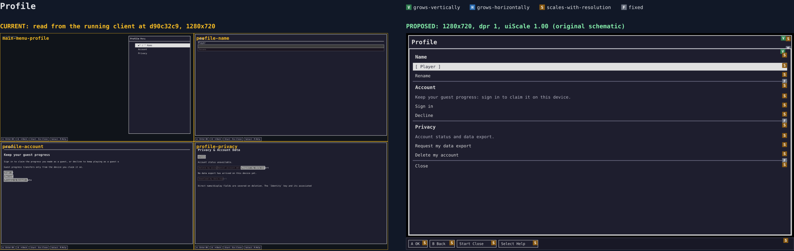](wireframes/svg/profile.svg)
Shipped: [sub-list](wireframes/shipped/main-menu-profile.jpg), [Name](wireframes/shipped/profile-name.jpg), [Account](wireframes/shipped/profile-account.jpg), [Privacy](wireframes/shipped/profile-privacy.jpg)

**Measured:** a sub-list in the menu box, then three sparse full screens (097); Name uses a title bar, Account a 21 px heading under a 14 px title, Privacy a 21 px heading and a Close at the top; native buttons at 13.33 px.
**Genre:** list and grid contract (one column walked by the D-pad, axis matching layout, 102); message channels (deletion phases are modal); empty states do not apply, since each section always has rows.
**Adopted:** #586 D3's one screen in the section order verdict above, section headers and separators from tokens, Close at the bottom (104).
**Rejected:** three tabs (the Social precedent), because tabs would keep three sparse pages, the operator's actual complaint, and the spec already rules it out (`uif-16b`).

### help-introduction

[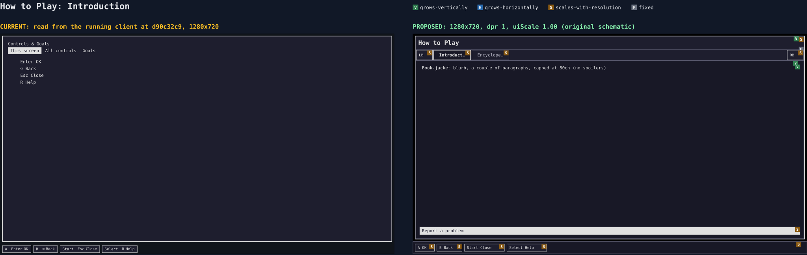](wireframes/svg/help-introduction.svg)
Shipped: [This screen](wireframes/shipped/help-screen.jpg), [All controls, retired](wireframes/shipped/help-controls.jpg)

**Measured:** title "Controls & Goals" in 14 px normal weight; "This screen" lists hint chips that the hint bar already shows, 4 rows on a screen with no actions (113).
**Genre:** tab-bar contract (Sea of Stars' options carry a How to Play tab); message channels (the hint bar is the live prompt, so it is not repeated).
**Adopted:** Introduction and Encyclopedia tabs (110, 113); a blurb capped at 80ch; a Report a problem row (`uif-14`).
**Rejected:** an All controls tab, because the Controls screen already fulfils it (110). A pixel-font heading is rejected since none ships.

### help-encyclopedia

[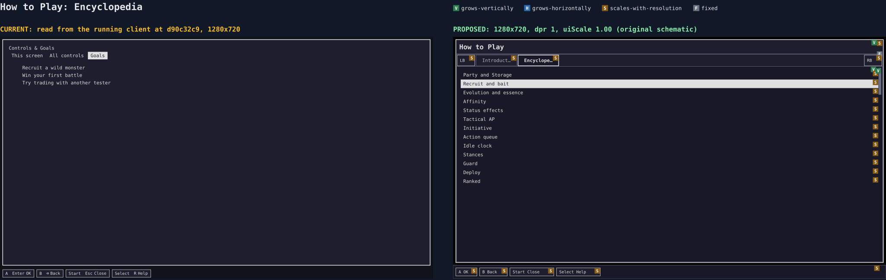](wireframes/svg/help-encyclopedia.svg)
Shipped: [Goals](wireframes/shipped/help-goals.jpg)

**Measured:** three static lines indented to x 66, no cursor.
**Genre:** list and grid contract (XAG 112 asks for a second route into bestiaries and logs; a remembered cursor; a position cue).
**Adopted:** one long list, cursor remembered per tab (`UIF14.4`).
**Rejected:** category tabs inside the tab, because a nested tab strip would break the one-strip rule and the 13 named terms do not need it. A search field is rejected since it needs a text-entry frame for a short list.

### help-detail

[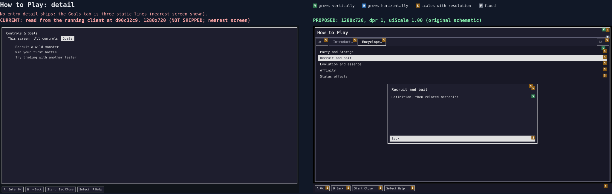](wireframes/svg/help-detail.svg)
Not shipped; nearest is [Goals](wireframes/shipped/help-goals.jpg).

**Measured:** nothing to measure: no entry detail exists.
**Genre:** context-menu contract (same frame family, returns to its row); message channels (the operator's 114 asks for "a modal or a dialog box above the menu").
**Adopted:** a modal panel in the frame (the ContextSheet's detail variant, WF1-A8), B returning to the same entry, a click outside closing it through the kit's pointer rule; centered, not corner-anchored, because it holds prose rather than actions.
**Rejected:** a new `OverlayId`, because each costs about 25 pins for identical behavior; a full page is rejected since 114 asks for the list to stay visible behind it.

### controls-buttons

[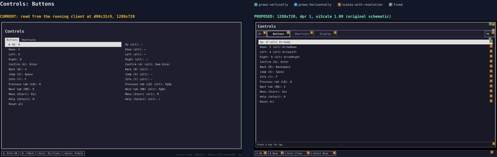](wireframes/svg/controls-buttons.svg)
Shipped: [Buttons](wireframes/shipped/controls-buttons.jpg)

**Measured:** title 21 px at y 39; tabs at y 90.4; a 2-column binding grid with a dashed outline around the whole list; capture and outcome text in flow.
**Genre:** tab-bar contract; list and grid contract (a grid clamps); message channels (the capture prompt is a hint, the outcome a toast).
**Adopted:** TabBar; rows per the shipped `CONTROLS_LAYOUT` columns (the wireframe's single-column labels are schematic); the capture prompt on the strip; `Saved.` as a toast.
**Rejected:** moving bindings to a sheet, because a remap is a long comparison across rows that needs the whole table visible (research §3).

### controls-shortcuts

[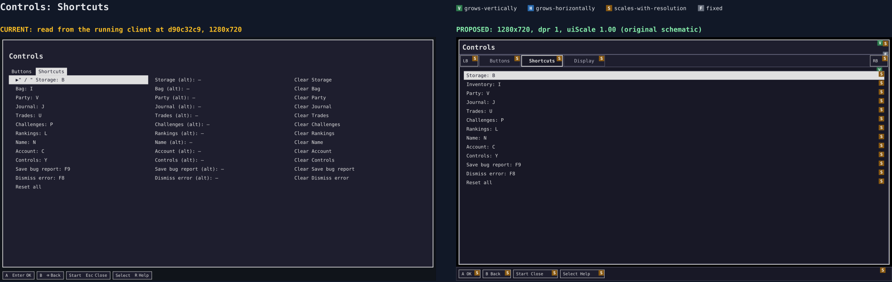](wireframes/svg/controls-shortcuts.svg)
Shipped: [Shortcuts](wireframes/shipped/controls-shortcuts.jpg)

**Measured:** the same frame as Buttons with a third column for Clear rows.
**Genre:** tab-bar contract; list and grid contract.
**Adopted:** the Buttons treatment; Reset all confirm in the ContextSheet confirm variant with its shipped default of No (`UIF13.1`).
**Rejected:** merging Buttons and Shortcuts into one list, because hotkeys are optional by doctrine and mixing them would bury the virtual buttons.

### controls-display

[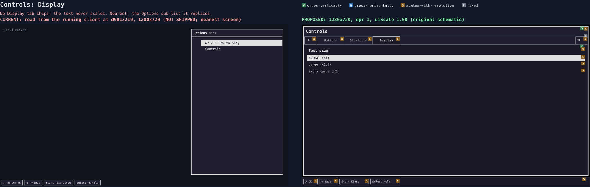](wireframes/svg/controls-display.svg)
Not shipped; nearest is the [Options sub-list](wireframes/shipped/main-menu-options.jpg) it replaces.

**Measured:** no text-size control exists at any path; the shipped UI never scales (131).
**Genre:** list and grid contract (short list, wrap); XAG 101's 200% text requirement; research §9's "user UI scale" design.
**Adopted:** a Display tab with ×1, ×1.5 and ×2 (#586 D1), persisted per browser (`uif-13`).
**Rejected:** a free slider, because a D-pad player gets no precise control from it and three steps meet the 200% floor. A separate world scale is rejected since #586 D1 re-affirmed integer world scaling.

### shop

[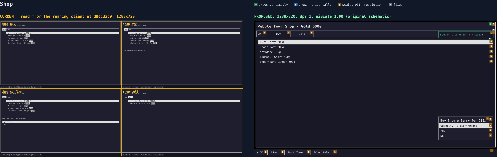](wireframes/svg/shop.svg)
Shipped: [Buy](wireframes/shipped/shop-buy.jpg), [quantity](wireframes/shipped/shop-qty.jpg), [confirm](wireframes/shipped/shop-confirm.jpg), [Sell](wireframes/shipped/shop-sell.jpg)

**Measured:** title 14 px in a 60 px title bar with the balance beside it; tabs at y 82.4; every row carries a native 39×21 Buy button beside a row that A already activates; the quantity and confirm prompts stack in flow under the list at y 307.
**Genre:** context-menu contract (Bag's quantity box sits in the same corner); message channels (results as a toast near the source); list and grid contract (a reviewer faults a shop with no way to judge an item, so rows keep price and detail).
**Adopted:** the frame, TabBar, two phases as shipped: quantity (drawn, Left/Right on its row, `UIF10.4`), then the confirm variant replacing those rows with the shipped defaults (Buy Yes, Sell No, `UIF10.1`); the result as a toast after the sheet closes.
**Rejected:** removing the per-row Buy button in this milestone, because `shopView` renders it for the pointer path and `uif-10` scopes kit adoption, not a pointer rethink; dropping the confirm is rejected since a spend has no undo, and NN/g keeps confirms for exactly such consequences.

### heal

[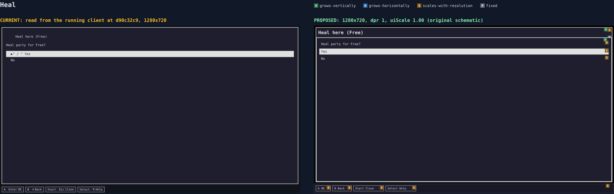](wireframes/svg/heal.svg)
Shipped: [Heal](wireframes/shipped/heal.jpg)

**Measured:** a header at x 66 (list-style indent) with the question at x 26; full-width Yes and No rows.
**Genre:** context-menu contract (a confirm with a safe default); message channels.
**Adopted:** the frame and the title bar; the rows as shipped.
**Rejected:** shrinking Heal to a ContextSheet, because `UIF10.3` keeps it on the frame anatomy and a free heal needs no decision weight; a toast-only result is rejected since the party state itself shows the heal.

### dialogue

[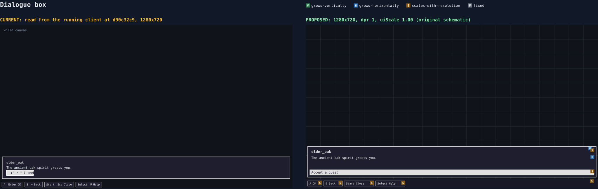](wireframes/svg/dialogue.svg)
Shipped: [dialogue](wireframes/shipped/dialogue.jpg)

**Measured:** a bottom frame at 10, 582, 1260×96 with the NPC name, line and choices; grows upward with content; store-reconciled, so `dialogueView` is not touched.
**Genre:** message channels (the blocking text box; the Gen 3 dialogue frame spans the screen bottom).
**Adopted:** the shipped layout; it scales only through tokens.
**Rejected:** portraits and typewriter pacing, because no art ships for them and they are a dialogue feature, not a menu one. Moving it to the top is rejected since research §5 and the hint bar both anchor the bottom.

### trade-propose

[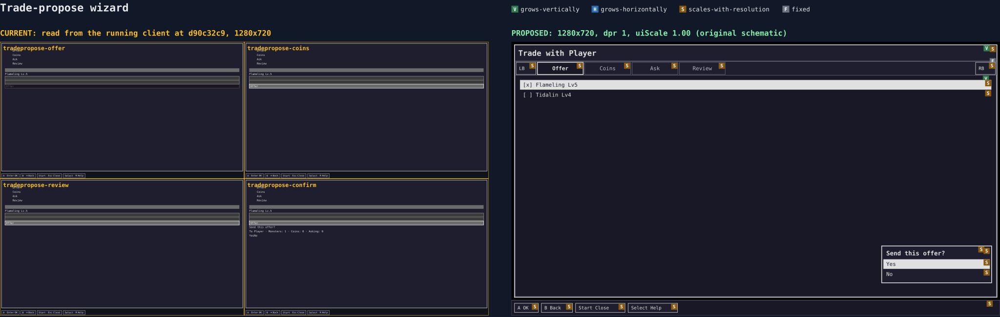](wireframes/svg/trade-propose.svg)
Shipped: [Offer](wireframes/shipped/tradepropose-offer.jpg), [Coins](wireframes/shipped/tradepropose-coins.jpg), [Review](wireframes/shipped/tradepropose-review.jpg), [confirm](wireframes/shipped/tradepropose-confirm.jpg)

**Measured:** four numbered lines stacked at x 66 as a step header, 90 px tall; one form holds every step; Yes and No inline at y 291.
**Genre:** tab-bar contract (a wizard's steps sit in the strip's slot and use LB/RB as shipped); context-menu contract (the final confirm).
**Adopted:** the step header in the TabBar's slot and geometry, kept as `ol` with `aria-current="step"`; the confirm variant; the same message sent (`UIF10.4`).
**Rejected:** real `role="tablist"` semantics, because a wizard's steps are a sequence, and e2e pins the `aria-current` shape. Splitting it into four frames is rejected since it needs new `OverlayId`s for one form.

### world-sheets

[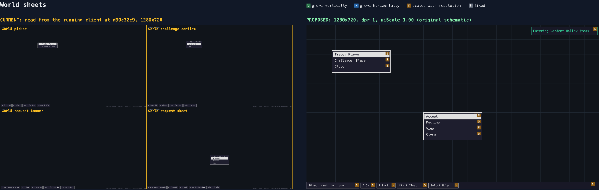](wireframes/svg/world-sheets.svg)
Shipped: [picker](wireframes/shipped/world-picker.jpg), [challenge pick](wireframes/shipped/world-challenge-confirm.jpg), [request banner](wireframes/shipped/world-request-banner.jpg), [request sheet](wireframes/shipped/world-request-sheet.jpg)

**Measured:** a 12 px prompt near the tile (`pointer-events:none`), a request sheet low and centred at 557, 421, 166×83, and the request as the first chip of the hint bar; none has a Close row (049).
**Genre:** context-menu contract (same frame family; closes on cancel); message channels (a request is a persistent banner, not a toast).
**Adopted:** the ContextSheet family staying anchored as shipped; a last Close row; rows that accept clicks (`uif-12`); zone cues as a toast.
**Rejected:** the corner anchor for world sheets, because the sheet belongs to a tile in the world, and a sheet in a screen corner would lose that link; frames for requests are rejected since DECISIONS "server-owned frames" keeps them non-modal.

### tactics-deploy

[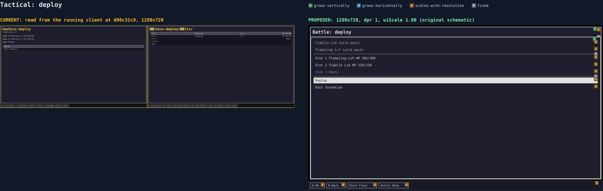](wireframes/svg/tactics-deploy.svg)
Shipped: [confirm](wireframes/shipped/tactics-deploy.jpg), [editor](wireframes/shipped/tactics-deploy-editor.jpg)

**Measured:** px text and rows on `.tactics-*` literals; no title; the wild pack and the own slots as flat lines.
**Genre:** list and grid contract (safe default, cursor on Deploy); context-menu contract (the same row treatment as every list).
**Adopted:** token type, spacing and rows only (`UIF11.2`, `UIF11.3`), section separators; flow and copy stand.
**Rejected:** a new layout or the TabBar here, because `M-battle-tactics-design.md` binds and `uif-11` is explicitly not a tactical redesign.

### tactics-board

[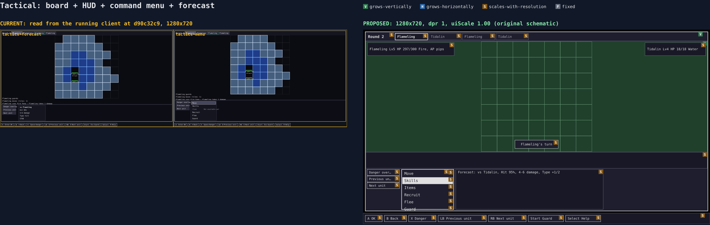](wireframes/svg/tactics-board.svg)
[Three window sizes](wireframes/svg/tactics-board-sizes.svg) · shipped: [forecast](wireframes/shipped/tactics-forecast.jpg), [command menu](wireframes/shipped/tactics-menu.jpg), [board](wireframes/shipped/tactics-board.jpg), [skills](wireframes/shipped/tactics-skills.jpg), [1920×1080](wireframes/shipped/tactics-board-1920.jpg)

**Measured:** the board already fills its box through fractional tracks, but turn chips stay 12 px, the dock 78 px, and the ticker 12 px at 1920×1080; the open dock grows to 156 px and pushes the ticker up; 13 px command rows with their own colors; the item command reads "Item".
**Genre:** list and grid contract (the same cursor and disabled treatment as `.mr-nav-item`); message channels (the ticker is a capped log; rejected orders are toasts); research §9's one-scale rule.
**Adopted:** every chrome length on the one scale, so the board keeps its share at any window (131); the shared row treatment; "Items" (#586 D4).
**Rejected:** a battle-only scale path, because M-battle-tactics rules out a fork, and moving the HUD or command menu, because the design doc binds them. The grown dock is a named cost, with the board's floor at doubled text (WF1-A7).

### tactics-results

[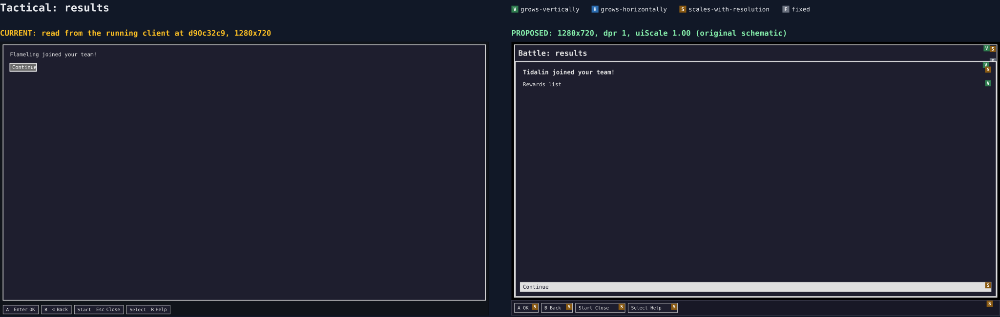](wireframes/svg/tactics-results.svg)
Shipped: [results](wireframes/shipped/tactics-results.jpg)

**Measured:** one 14 px line and a native 69×21 Continue button at the top of a 672 px frame.
**Genre:** message channels (a result the player reads before going on, the blocking-box job); empty states (a results panel with little to say still names its next step).
**Adopted:** a title, token type, the shared row for Continue (`UIF11.2`).
**Rejected:** auto-dismiss, because the operator must be able to read rewards, and toasts must not be the only carrier (research §5). A results sheet over the board is rejected since `UIF11.5` holds the shipped flow.

## Comparison for the PR

The wf-1 PR body carries one row per screen linking its spread and shipped screenshots. `uif-17` adds the as-shipped column once the kit lands (spec, "Post-integration verification" item 4).
